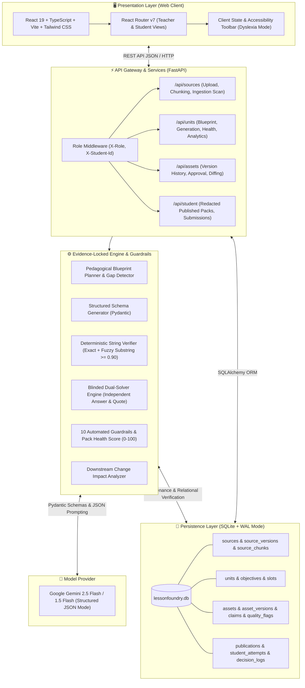
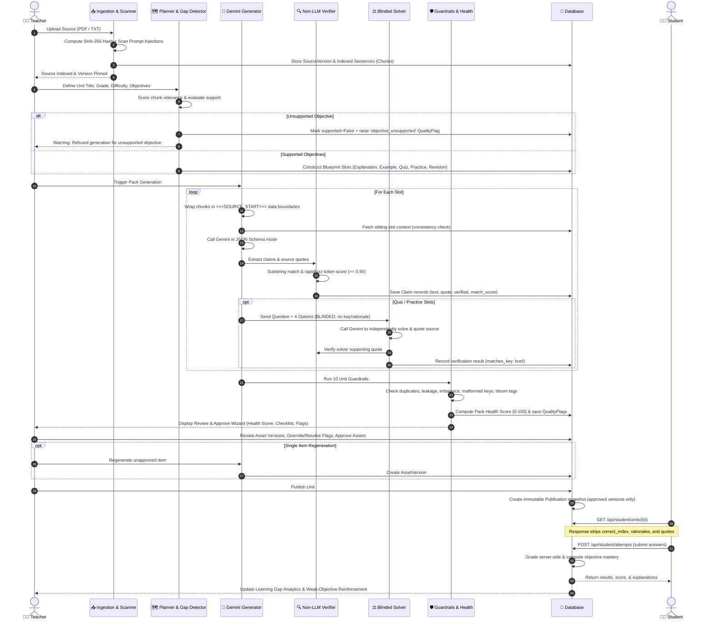

# LessonFoundry System Architecture & Workflows

LessonFoundry is an evidence-locked curriculum generation and assessment platform designed to eliminate AI hallucination, enforce pedagogical standards (Bloom's Taxonomy), and maintain immutable chain-of-custody provenance across educational artifacts.

---

## 1. System Architecture Diagram

---

## 2. Core Operational Workflow Diagram

---

## 3. Subsystem Breakdown

### 3.1. Non-LLM Verifier Engine (`engine/verifier.py`)
- **Zero-Trust Grounding**: The verifier operates strictly without LLM calls to prevent hallucination recursion.
- **Matching Pipeline**:
  1. *Exact Substring Search*: Direct containment in chunk text (`score = 1.0`).
  2. *Normalized Clean Search*: Strips smart quotes, trailing punctuation, and whitespace variations (`score = 1.0`).
  3. *Token-Level Fuzzy Match*: Calculates token-set ratio using `rapidfuzz` across sliding sentence windows (`threshold >= 0.90`).
- **Rejection Policy**: Any claim quote scoring `< 0.90` is flagged as unverified and blocked by the approval gate.

### 3.2. Blinded Dual-Solver Engine (`engine/solver.py`)
- **Blinded Execution**: Solves each generated assessment item by feeding only the question stem, 4 option choices, and the relevant source chunks.
- **Strict Isolation**: Never exposes the answer key, authoring rationale, or original quotes to the solver prompt.
- **Double Verification**: The solver must provide its own supporting quote, which is verified by the non-LLM verifier. If the solver disagrees with the answer key or fails quote verification, an `answer_key_mismatch` QualityFlag (Severity: Error) is raised.

### 3.3. Deterministic Guardrails Engine (`engine/guardrails.py`)
The platform continuously runs 10 deterministic guardrails:
1. `duplicate_question`: Identifies semantic duplicates across quiz and practice items via token Jaccard and RapidFuzz similarity ($\ge 80\%$).
2. `answer_leakage`: Detects exact correct answer text or full token sets appearing inside the question stem.
3. `unsupported_claims`: Catches any claim with an unverified source quote.
4. `objective_coverage_imbalance`: Flags units where item distribution is skewed across objectives.
5. `missing_objective_coverage`: Blocks publication if a supported objective has 0 generated items.
6. `malformed_key`: Validates 4 distinct options and valid 0-3 integer answer key.
7. `difficulty_mismatch`: Ensures advanced practice items demonstrate higher average Bloom taxonomy depth than foundation items.
8. `unsupported_revision_concept`: Flags revision glossary terms that were not introduced in the primary explanation.
9. `terminology_drift`: Detects contradictory definitions across different slots for the same objective.
10. `injection_flagged_source`: Audits whether the source contains prompt injection triggers and enforces strict delimiter isolation.

---

## 4. Security & Data Integrity Boundaries

- **Untrusted Source Delimiters**: All ingested texts are enclosed within strict `<<<SOURCE_START>>>` and `<<<SOURCE_END>>>` markers. System prompts explicitly command the model to treat content inside delimiters as untrusted data.
- **Redacted Student Endpoints**: Endpoints under `/api/student/` query only immutable `Publication` records and explicitly filter out `correct_index`, `rationale`, and evidence quotes prior to student submission.
- **Zero Client-Side Secrets**: All API keys and model configurations remain server-side in `.env`.
